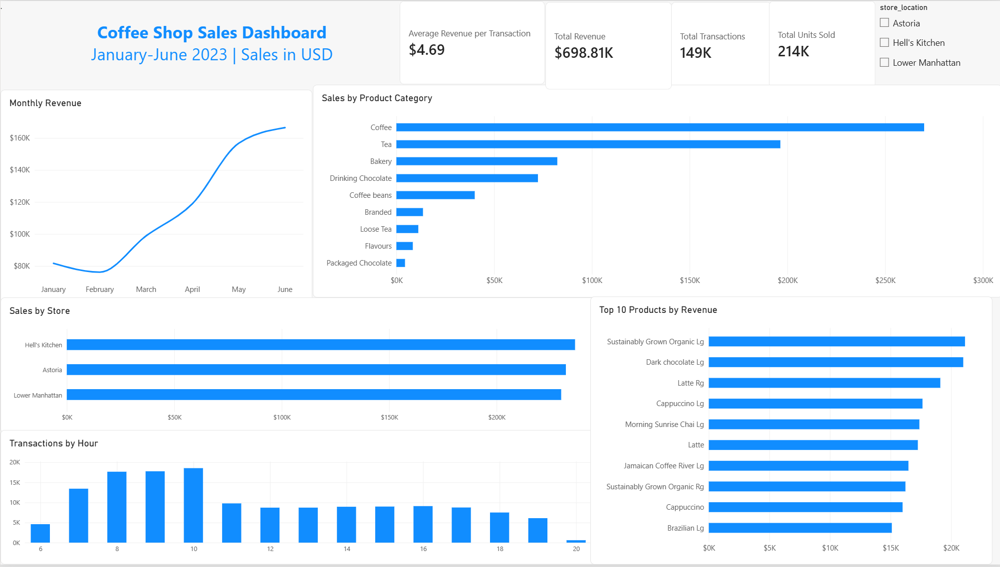

# Coffee Shop Sales Analysis

## About the Project

I built this project to practice analyzing sales data with SQL and presenting the results in Power BI.

The data covers January to June 2023 across three coffee shop locations: Astoria, Hell’s Kitchen, and Lower Manhattan.

I used MySQL to check the data and analyze sales by store, month, product, and hour. Then I built a Power BI dashboard with a store filter and checked that the revenue totals matched my SQL results.

## Tools Used

- MySQL / MySQL Workbench
- Power BI Desktop
- DAX

## What I Found

The stores generated **$698,812.33 in revenue** from **149,116 transactions**, selling **214,470 units**. Average revenue per transaction was **$4.69**.

- June had the highest revenue at $166,485.88.
- Sales dropped in February, then increased each month through June.
- Hell’s Kitchen had the highest store revenue at $236,511.17, although all three stores contributed similar amounts.
- Coffee and tea accounted for 66.74% of total revenue.
- About 36% of transactions occurred between 8 and 11 a.m., with 10–11 a.m. being the busiest hour.

## Project Files

- SQL script with data checks and analysis queries
- Power BI report (.pbix)
- Dashboard screenshot (.png)

## Data Source

Educational sample data from [Maven Analytics — Coffee Shop Sales](https://mavenanalytics.io/data-playground/coffee-shop-sales).

